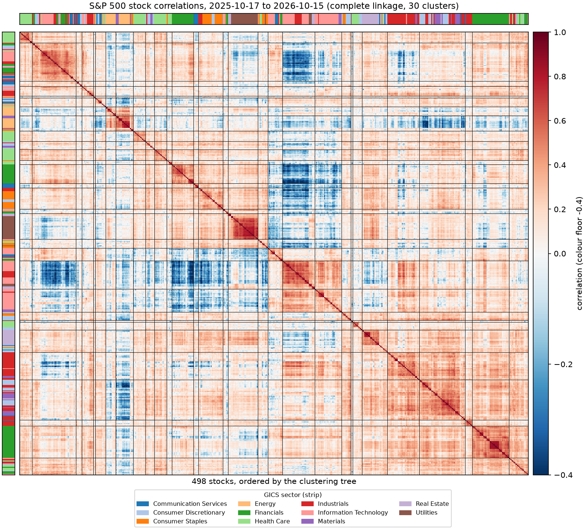

# sp500-market-structure

Which S&P 500 stocks move together? This project clusters stocks by how their daily returns
correlate, **without looking at sector labels**, and then checks how well the clusters line up
with the GICS sectors.



*Correlation of daily returns for 498 stocks (2025-10-17 to 2026-10-15), ordered by the clustering
tree. Black lines separate 30 clusters; the coloured strips are the sectors, shown only for
comparison.*

## Run it (one command)

Requires Python 3.11 or newer and an internet connection for the first run.

```powershell
git clone https://github.com/JPLai/sp500-market-structure.git
cd sp500-market-structure
python -m venv .venv
.\.venv\Scripts\Activate.ps1          # macOS/Linux: source .venv/bin/activate
pip install -e .
market-structure step1
```

The last command downloads the data (about a minute, saved under `data/raw/` and reused next
time), builds the correlation matrix, clusters the stocks with four linkage methods, and writes
tables, figures and a report to `output/step1/`. Start with
[`output/step1/step1_report.md`](output/step1/step1_report.md).

Useful options (all optional, see `market-structure step1 --help`):

| option | meaning |
|---|---|
| `--start`, `--end` | date window, `YYYY-MM-DD`, end exclusive (default: the last 365 days) |
| `--linkage`, `--k` | force a linkage / number of clusters (default: highest silhouette) |
| `--bootstrap N` | resamples for the stability check, `0` to skip (default 100) |
| `--refresh-data` | download again instead of using the saved copy |
| `--output-dir`, `--data-dir` | where results and downloaded data go |

The numbers in this repository were produced with
`market-structure step1 --start 2025-10-16 --end 2026-10-16`.

## What it found (one year, 498 stocks)

- **Sectors matter, but only partly.** Two stocks in the same sector have an average correlation
  of 0.25, against 0.10 for stocks in different sectors. Clusters agree with sectors moderately
  (adjusted Rand index about 0.3 at best).
- **Some groups are very clean** (banks and brokers, insurers, utilities, oil and gas, three
  separate Health Care groups), **others are mixed** (the two biggest clusters span five to seven
  sectors).
- **There is no natural number of clusters.** Silhouette scores stay below 0.1 for every
  linkage and every `k`, so the 30-cluster cut is a convenient view, not a discovery.
- **Single linkage fails** (99% of stocks in one cluster); complete and Ward linkage give balanced
  clusters.
- **About half of the grouping is stable** when the trading days are resampled (median adjusted
  Rand index 0.50).

Details, definitions and cautions are in [`docs/step1_market_map.md`](docs/step1_market_map.md).

## Method in brief

1. Daily log returns of adjusted closes; only stocks with a complete year are used.
2. Pearson correlation `C[i,j]` for every pair of stocks.
3. Distance `d[i,j] = sqrt(2 (1 - C[i,j]))`, a true Euclidean distance (checked on every run).
4. Agglomerative clustering with single, complete, average and Ward linkage.
5. Number of clusters and linkage chosen by silhouette, a rule that never sees the sectors;
   sensitivity to `k`, to the linkage and to the sample of days is reported.

## Repository layout

| path | content |
|---|---|
| `src/market_structure/` | the code (data, returns, clustering, summaries, plotting, report, CLI) |
| `tests/` | offline unit and end-to-end tests on synthetic data |
| `docs/step1_market_map.md` | method, results and limitations in plain language |
| `output/step1/` | figures, tables and the generated report from the run above |
| `data/raw/` | downloaded data (not committed) |

Run the checks with `pip install -e ".[dev]"`, then `pytest` and `ruff check .`.

## Limits and disclaimer

One year of data, today's index members (survivorship bias), 498 of 503 stocks (those with a full
history), and correlation is not causation. This is a research project, **not investment advice**.

## Data and licence

Prices come from Yahoo Finance through the `yfinance` package and are for personal research use;
they are not redistributed here. Sector labels come from the Wikipedia article
[List of S&P 500 companies](https://en.wikipedia.org/wiki/List_of_S%26P_500_companies)
(CC BY-SA 4.0), where GICS is a trademark of MSCI and S&P. The derived tables in `output/step1/`
contain tickers, company names and sector labels from that list. Code is under the
[MIT licence](LICENSE).
