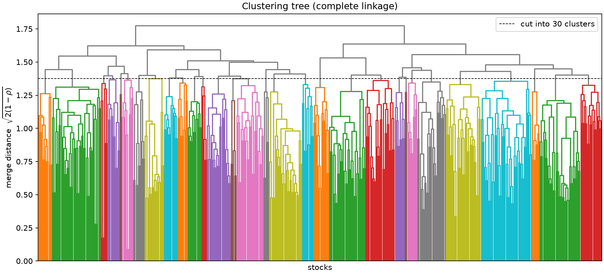
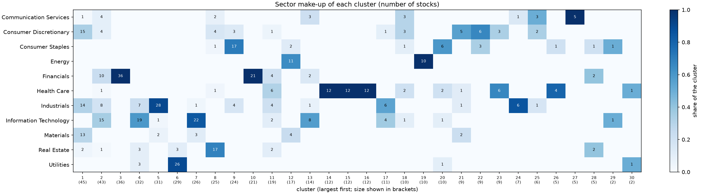
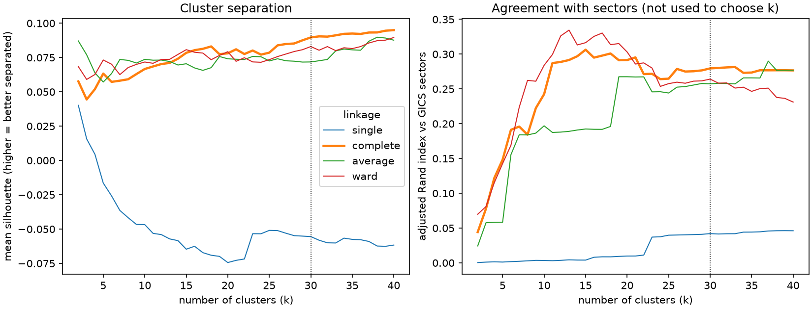
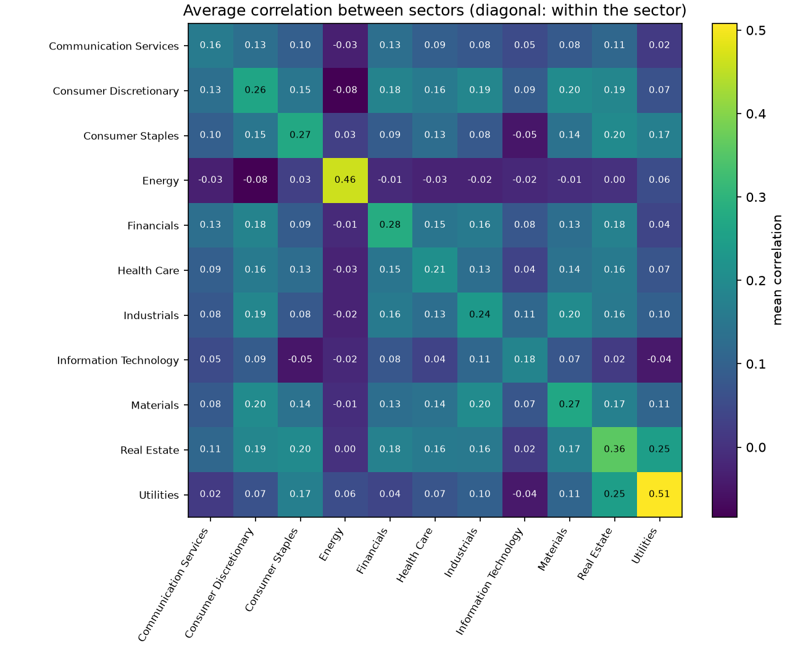

# Market map results

_Generated by `market-structure step1`; do not edit by hand. Interpretation is in [docs/step1_market_map.md](../../docs/step1_market_map.md)._

## Data

- Window requested: 2025-10-16 to 2026-10-16 (end exclusive); daily returns from 2025-10-17 to 2026-10-15 (250 days).
- Universe: 503 current S&P 500 members; 498 have a return on every day and are clustered, 5 are excluded ([excluded_stocks.csv](excluded_stocks.csv)).
- Returns are daily log returns of dividend- and split-adjusted closes. Nothing is filled in.

## Method

- Correlation: Pearson correlation of daily returns, `C[i,j]`.
- Distance: `d[i,j] = sqrt(2 (1 - C[i,j]))` (0 for correlation 1, 1.41 for 0, 2 for -1).
- Linkages compared: single, complete, average, ward. Ward linkage was included because the correlation matrix is positive semi-definite, so the distance is Euclidean.
- Choice of linkage and number of clusters k: highest silhouette over single, complete, average, ward and k = 5-30. Sector labels are never used for this.

## Linkage comparison

| linkage | cophenetic_correlation | best_k | silhouette | largest_cluster_share | singletons | ari_vs_sectors |
|---|---|---|---|---|---|---|
| single | 0.425 | 5 | -0.016 | 99.2% | 4 | 0.001 |
| complete | 0.565 | 30 | 0.090 | 9.0% | 0 | 0.280 |
| average | 0.711 | 23 | 0.076 | 29.9% | 5 | 0.246 |
| ward | 0.545 | 30 | 0.083 | 6.8% | 0 | 0.264 |

`best_k` is the k with the highest silhouette in the allowed range; the last three columns describe that cut. Cophenetic correlation says how faithfully the tree keeps the original distances.

## Chosen clustering

**complete linkage, 30 clusters** (silhouette 0.090, largest cluster 9% of the stocks, 0 single-stock clusters). Cluster sizes: 45, 43, 36, 32, 31, 29, 26, 25, 24, 21, 19, 17, 14, 12, 12, 12, 11, 10, 10, 10, 9, 9, 9, 7, 6, 5, 5, 5, 2, 2.

> **Note:** the best k sits at the edge of the allowed range (5-30). The silhouette has no clear peak, so the data show no natural number of clusters; this k is a convenient cut, not a discovered one. See the sensitivity plot.

| cluster | size | mean_within_correlation | dominant_sector | dominant_sector_share | sectors | most_central |
|---|---|---|---|---|---|---|
| 1 | 45 | 0.429 | Consumer Discretionary | 33% | 5 | PHM, PPG, SHW |
| 2 | 43 | 0.425 | Information Technology | 35% | 7 | ADP, PAYX, EFX |
| 3 | 36 | 0.523 | Financials | 100% | 1 | USB, KEY, CFG |
| 4 | 32 | 0.511 | Information Technology | 59% | 4 | LRCX, FIX, AMAT |
| 5 | 31 | 0.416 | Industrials | 90% | 3 | WAB, AME, EMR |
| 6 | 29 | 0.571 | Utilities | 90% | 2 | AEE, LNT, CMS |
| 7 | 26 | 0.332 | Information Technology | 85% | 3 | ADI, ON, MCHP |
| 8 | 25 | 0.375 | Real Estate | 68% | 5 | UDR, MAA, CPT |
| 9 | 24 | 0.371 | Consumer Staples | 71% | 3 | CL, PEP, GIS |
| 10 | 21 | 0.484 | Financials | 100% | 1 | HIG, ACGL, CB |
| 11 | 19 | 0.326 | Health Care | 32% | 6 | CBRE, GPN, ALGN |
| 12 | 17 | 0.534 | Energy | 65% | 3 | COP, EOG, OXY |
| 13 | 14 | 0.370 | Information Technology | 57% | 4 | CRWD, PLTR, PANW |
| 14 | 12 | 0.464 | Health Care | 100% | 1 | TMO, A, RVTY |
| 15 | 12 | 0.417 | Health Care | 100% | 1 | AMGN, VRTX, BMY |
| 16 | 12 | 0.410 | Health Care | 100% | 1 | SYK, BDX, MDT |
| 17 | 11 | 0.287 | Industrials | 55% | 3 | ODFL, JBHT, FDX |
| 18 | 10 | 0.253 | Consumer Discretionary | 30% | 5 | GOOG, GOOGL, AMZN |
| 19 | 10 | 0.382 | Energy | 100% | 1 | OKE, TRGP, KMI |
| 20 | 10 | 0.266 | Consumer Staples | 60% | 4 | COST, PM, MO |
| 21 | 9 | 0.246 | Consumer Discretionary | 56% | 4 | YUM, MCD, OTIS |
| 22 | 9 | 0.356 | Consumer Discretionary | 67% | 2 | DLTR, WSM, RL |
| 23 | 9 | 0.333 | Health Care | 67% | 2 | UNH, ELV, CVS |
| 24 | 7 | 0.476 | Industrials | 86% | 2 | NOC, LHX, LMT |
| 25 | 6 | 0.261 | Communication Services | 50% | 3 | FOX, FOXA, LVS |
| 26 | 5 | 0.326 | Health Care | 80% | 2 | MCK, COR, CAH |
| 27 | 5 | 0.504 | Communication Services | 100% | 1 | T, VZ, TMUS |
| 28 | 5 | 0.320 | Financials | 40% | 3 | WELL, VTR, CME |
| 29 | 2 | 0.211 | Information Technology | 50% | 2 | AKAM, MNST |
| 30 | 2 | 0.188 | Utilities | 50% | 2 | AES, DVA |

## Sensitivity

- Agreement between linkages at k = 30 (adjusted Rand index):

| linkage | single | complete | average | ward |
|---|---|---|---|---|
| single | 1.00 | 0.02 | 0.09 | 0.01 |
| complete | 0.02 | 1.00 | 0.40 | 0.56 |
| average | 0.09 | 0.40 | 1.00 | 0.32 |
| ward | 0.01 | 0.56 | 0.32 | 1.00 |

- Stability to the sample of days: 100 resamples of the trading days (with replacement), rebuilding the tree each time and comparing its cut with the full-sample clusters by adjusted Rand index: median 0.50, 5th to 95th percentile 0.44 to 0.56 (1 = identical grouping).

## Sectors and correlation

| pairs | count | mean_correlation | median_correlation |
|---|---|---|---|
| all pairs | 123753 | 0.118 | 0.115 |
| same sector | 13712 | 0.252 | 0.247 |
| different sector | 110041 | 0.101 | 0.103 |
| same cluster | 5963 | 0.437 | 0.420 |
| different cluster | 117790 | 0.102 | 0.105 |

Average correlation within a sector is 0.252 against 0.101 across sectors.

## Strongest pairs (top 10)

| rank | symbol_a | symbol_b | correlation | same_company | same_sector | same_cluster |
|---|---|---|---|---|---|---|
| 1 | GOOGL | GOOG | 0.996 | True | True | True |
| 2 | FOXA | FOX | 0.985 | True | True | True |
| 3 | NWSA | NWS | 0.961 | True | True | True |
| 4 | NSC | UNP | 0.943 | False | True | True |
| 5 | CPT | MAA | 0.924 | False | True | True |
| 6 | DHI | PHM | 0.906 | False | True | True |
| 7 | AMAT | LRCX | 0.905 | False | True | True |
| 8 | MTB | RF | 0.899 | False | True | True |
| 9 | DAL | UAL | 0.897 | False | True | True |
| 10 | CFG | KEY | 0.895 | False | True | True |

`same_company` marks two share classes of one company. All pairs are in [strongest_pairs.csv](strongest_pairs.csv) and [most_negative_pairs.csv](most_negative_pairs.csv).

## Caveats

- The universe is today's S&P 500 applied to the past year, so stocks that left the index are missing (survivorship bias).
- 5 stocks without a complete history are not clustered.
- The window has 250 daily observations, so correlations are noisy, and the result describes this window only.
- There are more stocks (498) than days (250), so the correlation matrix is singular (rank below the number of stocks). It is still valid for clustering, but individual correlations are noisy.
- Correlation is not causation. Clusters describe stocks that moved together, nothing more.
- The bootstrap treats days as independent (seed 0); returns are not exactly so.
- This is research output, not investment advice.
